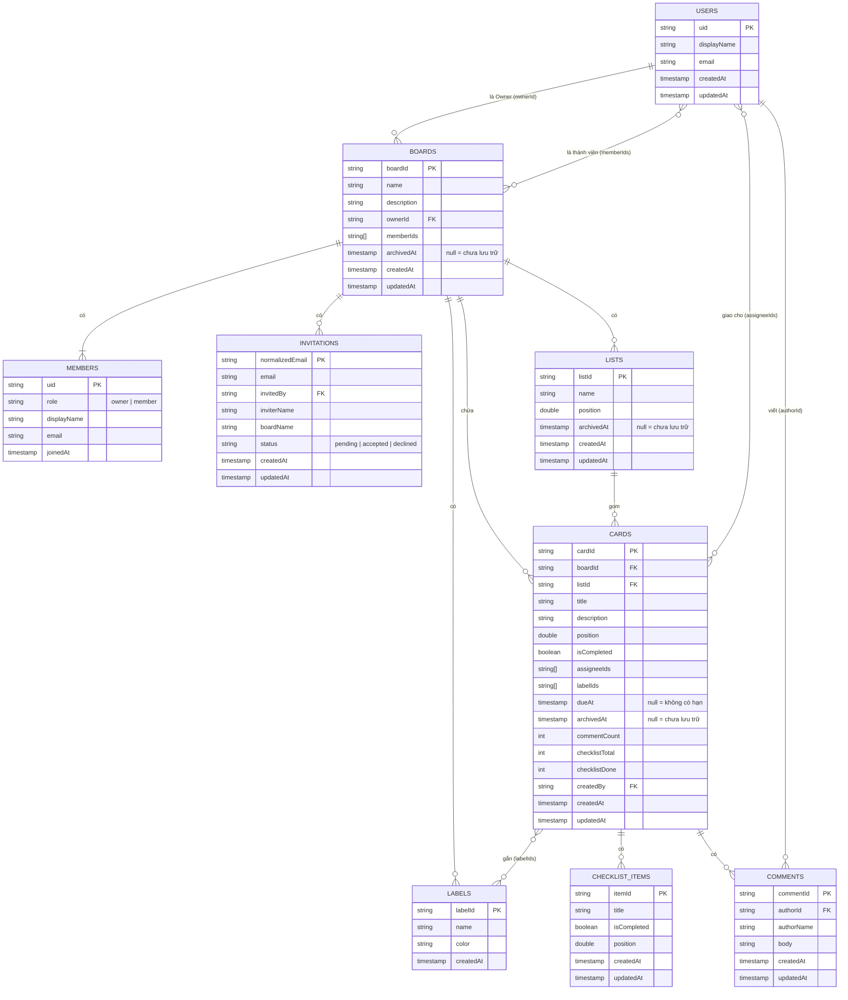

# Thiết kế cơ sở dữ liệu Firestore – Smart Todo

> **Trạng thái:** Bản thiết kế v1.0, thay thế bản đề xuất cũ. Có một số mục đang chờ nhóm xác nhận, xem [`database-open-questions.md`](database-open-questions.md).
> **Căn cứ:** Đặc tả use case UC01–UC08 (file `Dac_ta_use_case.docx`).
> **Tài liệu liên quan:**
> [Truy vấn & thao tác ghi](firestore-access-patterns.md) ·
> [Phân quyền & Security Rules](firestore-security.md) ·
> [Ma trận use case ↔ dữ liệu](usecase-data-matrix.md) ·
> [Câu hỏi cần chốt](database-open-questions.md)

---

## 0. Đọc tài liệu này như thế nào?

Firestore không lưu dữ liệu thành các bảng như Excel. Nó lưu thành **"tủ hồ sơ"**:

| Thuật ngữ | Hiểu đơn giản | Ví dụ |
|---|---|---|
| **Collection** | Một ngăn tủ chứa nhiều hồ sơ cùng loại | `boards` |
| **Document** | Một tờ hồ sơ, có mã số riêng (ID) | Một board cụ thể |
| **Field** | Một ô thông tin trên tờ hồ sơ | `name`, `dueAt` |
| **Subcollection** | Ngăn kéo nhỏ nằm *bên trong* một tờ hồ sơ | `lists` nằm trong một board |

Trong tài liệu, `boards/{boardId}/lists/{listId}` là **đường dẫn** tới một tờ hồ sơ. Phần trong `{}` là mã số (ID) thay đổi theo từng hồ sơ.

---

## 1. Cấu trúc tổng thể

```text
users/{uid}                          Hồ sơ người dùng (uid lấy từ Firebase Authentication)

boards/{boardId}                     Một board
 ├─ members/{uid}                    Thành viên của board (id = uid)
 ├─ invitations/{emailChuanHoa}      Lời mời vào board (id = email viết thường)
 ├─ labels/{labelId}                 Nhãn màu của board
 ├─ lists/{listId}                   Các cột (list)
 └─ cards/{cardId}                   Các thẻ công việc
     ├─ checklist/{itemId}           Các mục checklist của thẻ
     └─ comments/{commentId}         Bình luận của thẻ
```

Mật khẩu **không** nằm trong Firestore. Firebase Authentication giữ riêng email và mật khẩu. Collection `users` chỉ giữ thông tin hồ sơ đi kèm tài khoản.

---

## 2. Sơ đồ quan hệ (ERD)

GitHub tự vẽ sơ đồ này từ đoạn mã bên dưới. Bản ảnh nằm ở [`images/erd.png`](images/erd.png).



---

## 3. Quy ước chung

| # | Quy ước | Lý do |
|---|---|---|
| Q1 | ID của board, list, card, nhãn, mục checklist, bình luận: **ID tự sinh** của Firestore (`doc()` không truyền id) | Không đụng hàng, không đoán được |
| Q2 | ID đặc biệt: `users/{uid}` dùng uid của Auth; `members/{uid}` dùng uid; `invitations/{email viết thường}` | Tra cứu trực tiếp, chống trùng ngay ở tầng dữ liệu |
| Q3 | Tên trường **camelCase**; trường true/false bắt đầu bằng `is`; trường chứa danh sách ID kết thúc bằng `Ids` | Cả nhóm đặt tên giống nhau |
| Q4 | Thời gian dùng kiểu **Timestamp**, lấy giờ **máy chủ** (`FieldValue.serverTimestamp()`) cho `createdAt`/`updatedAt`/`joinedAt` | Giờ máy điện thoại có thể sai |
| Q5 | **Luôn ghi đủ mọi trường**. Trống thì ghi `null`, `""` hoặc `[]`, không bỏ trường | Firestore lọc `== null` chỉ khớp trường **có mặt và bằng null**; trường vắng mặt thì không khớp |
| Q6 | Lưu trữ = ghi **thời điểm** vào `archivedAt`; chưa lưu trữ = `null`. Khôi phục = đặt lại `null` | Biết được *khi nào* bị lưu trữ |
| Q7 | Chuỗi được cắt khoảng trắng đầu/cuối (`trim`) trước khi kiểm tra độ dài và lưu | Tránh tên toàn dấu cách |
| Q8 | Số thứ tự `position` kiểu số thực, xem mục 5 của [access patterns](firestore-access-patterns.md#5-sắp-xếp-bằng-position-kéo-thả) | Kéo thả không phải ghi lại cả danh sách |
| Q9 | Email dùng để mời luôn được **chuẩn hóa** (trim + viết thường) thành `normalizedEmail` | So sánh email không phân biệt hoa/thường |

---

## 4. Từ điển dữ liệu

Cột **Nguồn** chỉ ra phần đặc tả sinh ra quy tắc đó. Chữ *"đề xuất"* nghĩa là đặc tả chưa quy định và đây là giá trị mình đề nghị, nhóm cần xác nhận (xem file câu hỏi cần chốt).

### 4.1. `users/{uid}`: hồ sơ người dùng

| Trường | Kiểu | Quy tắc | Nguồn |
|---|---|---|---|
| `displayName` | string | Bắt buộc, 1–100 ký tự | UC01 (họ tên); 100 là *đề xuất* |
| `email` | string | Bắt buộc, đúng email đăng ký | UC01 |
| `createdAt` | timestamp | Giờ máy chủ | – |
| `updatedAt` | timestamp | Giờ máy chủ | – |

Code đăng ký hiện tại trong repo đã ghi đúng 4 trường này.

### 4.2. `boards/{boardId}`: board

| Trường | Kiểu | Quy tắc | Nguồn |
|---|---|---|---|
| `name` | string | Bắt buộc, 1–100 ký tự | UC03 bước 6 |
| `description` | string | `""` nếu trống, tối đa 500 ký tự | UC03 bước 4; 500 là *đề xuất* |
| `ownerId` | string | uid của Owner, **không đổi** sau khi tạo | UC03 bước 7 |
| `memberIds` | string[] | Có ít nhất `ownerId`; là danh sách uid mọi thành viên | UC03 bước 2, UC06 |
| `archivedAt` | timestamp \| null | `null` = chưa lưu trữ | UC03 3c–3e |
| `createdAt` | timestamp | Giờ máy chủ | – |
| `updatedAt` | timestamp | Đổi khi sửa tên/mô tả, lưu trữ, khôi phục | UC03 bước 2 (sắp xếp) |

### 4.3. `boards/{boardId}/members/{uid}`: thành viên

| Trường | Kiểu | Quy tắc | Nguồn |
|---|---|---|---|
| `role` | string | `"owner"` hoặc `"member"` | UC06 |
| `displayName` | string | Chép từ hồ sơ lúc tham gia | UC06 bước 2 |
| `email` | string | Chép từ hồ sơ lúc tham gia | UC06 bước 2 |
| `joinedAt` | timestamp | Giờ máy chủ | – |

> **Quyền thật sự** được quyết định bởi `ownerId` và `memberIds` trên tờ board, không phải bởi `role` ở đây. `role` chỉ để hiển thị. Xem quyết định D2.

### 4.4. `boards/{boardId}/invitations/{normalizedEmail}`: lời mời

ID của tờ hồ sơ **chính là email đã chuẩn hóa**. Nhờ vậy mỗi board chỉ có tối đa một lời mời cho mỗi email, khớp quy tắc "chưa có lời mời đang chờ" của UC06 bước 4.

| Trường | Kiểu | Quy tắc | Nguồn |
|---|---|---|---|
| `email` | string | Email Owner đã nhập, đúng định dạng | UC06 bước 3–4 |
| `normalizedEmail` | string | `email` đã trim + viết thường; **bằng ID tờ hồ sơ** | Q9 |
| `invitedBy` | string | uid Owner đã mời | UC06 bước 7 |
| `inviterName` | string | Tên người mời (sao chép để hiển thị) | UC06 bước 7 |
| `boardName` | string | Tên board (sao chép để hiển thị) | UC06 bước 7 |
| `status` | string | `"pending"`, `"accepted"` hoặc `"declined"` | UC06 bước 5, 9, 8a |
| `createdAt` | timestamp | Giờ máy chủ | – |
| `updatedAt` | timestamp | Giờ máy chủ | – |

Owner hủy lời mời (UC06 2a) thì **xóa** tờ hồ sơ này.

### 4.5. `boards/{boardId}/labels/{labelId}`: nhãn

| Trường | Kiểu | Quy tắc | Nguồn |
|---|---|---|---|
| `name` | string | 1–50 ký tự | *đề xuất* (UC05 chỉ nhắc nhãn) |
| `color` | string | Mã màu `#RRGGBB` | *đề xuất* |
| `createdAt` | timestamp | Giờ máy chủ | – |

### 4.6. `boards/{boardId}/lists/{listId}`: list (cột)

| Trường | Kiểu | Quy tắc | Nguồn |
|---|---|---|---|
| `name` | string | 1–100 ký tự | UC04 bước 6 |
| `position` | double | Thứ tự trái → phải | UC04 bước 2, 7, 3e |
| `archivedAt` | timestamp \| null | `null` = chưa lưu trữ | UC04 3b–3c |
| `createdAt` | timestamp | Giờ máy chủ | – |
| `updatedAt` | timestamp | Giờ máy chủ | – |

List **không bị xóa**, chỉ lưu trữ (đặc tả không có chức năng xóa list).

### 4.7. `boards/{boardId}/cards/{cardId}`: thẻ công việc

| Trường | Kiểu | Quy tắc | Nguồn |
|---|---|---|---|
| `boardId` | string | Bằng ID board cha, **không đổi** | Phục vụ UC07 1b (truy vấn xuyên board) |
| `listId` | string | ID list hiện tại, **cùng board** | UC05 bước 7 |
| `title` | string | 1–200 ký tự | UC05 bước 6 |
| `description` | string | `""` nếu trống, tối đa 5000 ký tự | *đề xuất* (Chi tiết card) |
| `position` | double | Thứ tự trong list | UC05 bước 7 |
| `isCompleted` | boolean | Mặc định `false` | UC05 3c–3d |
| `assigneeIds` | string[] | **Chỉ chứa thành viên hiện tại** của board | UC06 1b |
| `labelIds` | string[] | ID các nhãn **của cùng board** | UC05 bước 2 |
| `dueAt` | timestamp \| null | `null` = không có hạn | UC07 |
| `archivedAt` | timestamp \| null | `null` = chưa lưu trữ | UC05 3e |
| `commentCount` | int | ≥ 0, bằng số bình luận | UC05 bước 2 |
| `checklistTotal` | int | ≥ 0, bằng số mục checklist | UC05 bước 2 |
| `checklistDone` | int | 0 ≤ giá trị ≤ `checklistTotal` | UC05 bước 2 |
| `createdBy` | string | uid người tạo, **không đổi** | UC05 bước 7 |
| `createdAt` | timestamp | Giờ máy chủ | UC05 bước 7 |
| `updatedAt` | timestamp | Giờ máy chủ | – |

Ví dụ một tờ hồ sơ card:

```json
{
  "boardId": "b1",
  "listId": "l2",
  "title": "Thiết kế giao diện trang chủ",
  "description": "",
  "position": 2048,
  "isCompleted": false,
  "assigneeIds": ["uidBinh"],
  "labelIds": ["lbUrgent"],
  "dueAt": "2026-10-24T09:00:00+07:00",
  "archivedAt": null,
  "commentCount": 2,
  "checklistTotal": 3,
  "checklistDone": 1,
  "createdBy": "uidAn",
  "createdAt": "2026-10-20T08:00:00+07:00",
  "updatedAt": "2026-10-22T14:30:00+07:00"
}
```

### 4.8. `boards/{boardId}/cards/{cardId}/checklist/{itemId}`: mục checklist

| Trường | Kiểu | Quy tắc | Nguồn |
|---|---|---|---|
| `title` | string | 1–200 ký tự | *đề xuất* |
| `isCompleted` | boolean | Mặc định `false` | UC05 bước 2 (tiến độ) |
| `position` | double | Thứ tự trong checklist | – |
| `createdAt` | timestamp | Giờ máy chủ | – |
| `updatedAt` | timestamp | Giờ máy chủ | – |

### 4.9. `boards/{boardId}/cards/{cardId}/comments/{commentId}`: bình luận

| Trường | Kiểu | Quy tắc | Nguồn |
|---|---|---|---|
| `authorId` | string | uid tác giả, **không đổi** | UC06 1d |
| `authorName` | string | Tên tác giả lúc viết (sao chép để hiển thị) | UC06 1d |
| `body` | string | 1–2000 ký tự | UC06 1d |
| `createdAt` | timestamp | Giờ máy chủ | UC06 1d |
| `updatedAt` | timestamp | Giờ máy chủ; lớn hơn `createdAt` nghĩa là *đã chỉnh sửa* | UC06 1d |

---

## 5. Dữ liệu được tính ra, không lưu

Những giá trị này thay đổi theo thời gian hoặc suy ra được từ dữ liệu khác. Nếu lưu, chúng sẽ sai đi hoặc lệch nhau.

| Giá trị | Cách tính | Vì sao không lưu |
|---|---|---|
| Trạng thái hạn chót của card (bình thường / sắp đến hạn / quá hạn / đã hoàn thành) | Từ `dueAt`, `isCompleted` và giờ hiện tại, xem [access patterns, mục 6](firestore-access-patterns.md#6-trạng-thái-hạn-chót-và-nhóm-công-việc-của-tôi) | Thời gian trôi thì trạng thái đổi mà không ai ghi lại |
| Nhóm trong "Công việc của tôi" (Quá hạn, Hôm nay, Sắp tới, Không có hạn) | Từ `dueAt` | Như trên |
| Phần trăm tiến độ checklist | `checklistDone / checklistTotal` | Suy ra từ hai số đã lưu |
| Card đã được chỉnh sửa bình luận hay chưa | `updatedAt > createdAt` | Suy ra được |
| Vai trò thật của một người trong board | `ownerId == uid` thì là Owner, ngược lại là Member | Chỉ có 2 vai trò |
| Từ khóa tìm kiếm không dấu | Bỏ dấu tiếng Việt ngay trên máy lúc tìm | Firestore không hỗ trợ tìm "chứa từ khóa" |

---

## 6. Ràng buộc toàn vẹn (mọi lúc đều phải đúng)

Đây là các "luật bất biến" của dữ liệu. Mọi thao tác ghi phải giữ chúng đúng. Script `firebase/seed/validate-seed.mjs` kiểm tra I1–I10 trên dữ liệu mẫu, và [`firestore.rules`](../firestore.rules) chặn một phần ngay ở máy chủ.

| Mã | Luật |
|---|---|
| I1 | `board.ownerId` có trong `board.memberIds` |
| I2 | `board.memberIds` khớp đúng tập ID các tờ hồ sơ trong `members`; người có `ownerId` là `owner`, còn lại là `member` |
| I3 | Mọi uid trong `card.assigneeIds` đều có trong `board.memberIds` |
| I4 | `card.boardId` bằng ID board cha; `card.listId` trỏ tới list **cùng board** |
| I5 | Mọi ID trong `card.labelIds` là nhãn có thật của board |
| I6 | `commentCount` = số tờ trong `comments`; `checklistTotal` = số tờ trong `checklist`; `checklistDone` = số mục có `isCompleted == true` |
| I7 | List đã lưu trữ thì mọi card của list đó cũng đã lưu trữ |
| I8 | `invitation` có ID bằng `normalizedEmail`; `status` thuộc `pending / accepted / declined` |
| I9 | Không có hai list cùng `position` trong một board; không có hai card cùng `position` trong một list |
| I10 | Một email không vừa là thành viên board vừa có lời mời `pending` ở board đó |

---

## 7. Các quyết định thiết kế và lý do

### D1. `boards` ở cấp gốc, mọi thứ thuộc board nằm bên trong làm subcollection
Mọi chức năng đều xoay quanh một board. Đặt lists, cards, labels... bên trong board giúp mở một board chỉ đọc đúng phần của board đó, và quyền truy cập kiểm tra một lần ở cấp board.

### D2. Quyền truy cập dựa vào `ownerId` + `memberIds` trên tờ board
Security Rules chỉ cần đọc **một** tờ hồ sơ (tờ board) để biết ai là thành viên, ai là Owner. `memberIds` còn dùng để tìm "các board có mình là thành viên" bằng một truy vấn. Collection `members` chỉ phục vụ **hiển thị** (tên, email, vai trò). Hai nơi này phải luôn khớp nhau (luật I2), nên mọi thao tác thêm/bớt thành viên phải ghi cả hai trong **một batch**.

### D3. Lời mời: ID = email chuẩn hóa, không có "hộp thư" riêng cho từng người
Bản đề xuất cũ lưu lời mời **hai nơi** (trong board và trong `users/{uid}/inbox`), và để tìm uid từ email phải cho đọc hồ sơ người khác, vi phạm quy tắc "chỉ đọc hồ sơ của chính mình". Thiết kế mới:
- Lời mời chỉ nằm một nơi: `boards/{boardId}/invitations/{email}`.
- Người được mời xem lời mời của mình bằng **truy vấn nhóm** (collection group query) tìm mọi `invitations` có `normalizedEmail` bằng email của mình và `status == "pending"`.
- Bản chất ID = email còn **chặn trùng lời mời** (UC06 bước 4) ngay ở tầng dữ liệu.
- Hệ quả tốt: mời một email **chưa có tài khoản** vẫn tạo được lời mời; khi người đó đăng ký bằng đúng email thì thấy ngay (xử lý câu hỏi Q2 ở file câu hỏi cần chốt).
- **Đánh đổi:** vì khớp theo email, nếu ai đó đăng ký trước bằng email của người khác (đặc tả không bắt xác minh email) thì họ sẽ thấy lời mời. Chấp nhận được ở quy mô đồ án; muốn chặt hơn thì bắt xác minh email khi đăng ký.

### D4. Lưu sẵn bộ đếm trong card
UC05 bước 2 yêu cầu mỗi thẻ tóm tắt hiện **số bình luận** và **tiến độ checklist**. Nếu không có bộ đếm, hiển thị 1 board 100 card phải đọc thêm dữ liệu con của 100 card, tốn gấp nhiều lần số lượt đọc (gói miễn phí chỉ có khoảng 50.000 lượt đọc/ngày). Bù lại, mỗi lần thêm/xóa bình luận hoặc mục checklist phải cập nhật bộ đếm trong cùng một batch.

*Phương án khác đã cân nhắc:* nhúng checklist thành mảng bên trong card, bớt hẳn bộ đếm checklist. Không chọn vì hai người cùng sửa checklist một lúc dễ ghi đè lẫn nhau, và Security Rules không kiểm tra được từng phần tử trong mảng.

### D5. Thêm `boardId` vào card
"Công việc của tôi" (UC07 1b) cần gom card của **mọi board**. Card nằm sâu trong từng board, nên truy vấn nhóm trả về card mà không biết thuộc board nào nếu không lưu `boardId`.

### D6. `archivedAt` luôn có mặt, `null` khi chưa lưu trữ
Xem quy ước Q5. Security Rules ép buộc `archivedAt` phải có khi tạo, tránh lỗi "tạo xong lại không hiện trong danh sách".

### D7. Lưu trữ list kéo theo lưu trữ các card trong list
UC04 3c: list và các card bên trong bị ẩn. Cách làm: khi lưu trữ list, ghi **cùng một `archivedAt`** vào list và mọi card của nó, trong một batch. Nhờ vậy các truy vấn card chỉ cần lọc `archivedAt == null`, kể cả "Công việc của tôi" (card của list đã lưu trữ không còn lọt vào). Nếu sau này có chức năng khôi phục list, chỉ khôi phục những card có `archivedAt` đúng bằng của list.

### D8. Không có Cloud Functions ở v1
Cloud Functions cần gói Firebase trả phí theo mức dùng (Blaze). Với đồ án, mọi thao tác nhiều bước (mời, chấp nhận, xóa thành viên, xóa card...) do **app thực hiện bằng batch/transaction**, và Security Rules làm lưới an toàn. Hệ quả: thông báo nhắc hạn chót (UC07 bước 7) đặt **tại máy** bằng thông báo cục bộ, chỉ nhắc trên thiết bị nơi người dùng đã mở app.

### D9. Tìm kiếm và lọc làm trên máy (UC08)
Firestore không tìm được "tiêu đề chứa từ khóa không phân biệt dấu". Vì app đã tải toàn bộ card của board để hiển thị và đồng bộ thời gian thực, việc lọc làm ngay trên danh sách đó. Cách này cũng khớp UC08 5b ("tiếp tục tìm trên dữ liệu đã tải") và không tốn thêm lượt đọc nào.

### D10. Tên người dùng được sao chép sang `members`, `comments`, `invitations`
Hiển thị tên không cần tra thêm hồ sơ người khác (người khác cũng không được đọc hồ sơ của mình). Đánh đổi: đổi tên sau đó thì các bản sao cũ **không** tự đổi. Chấp nhận được; đặc tả không có chức năng đổi tên.

---

## 8. Thay đổi so với bản đề xuất cũ

| # | Bản cũ | Bản này | Lý do |
|---|---|---|---|
| 1 | Lời mời lưu 2 nơi (board + `users/{uid}/inbox`) | Chỉ lưu trong board, người nhận truy vấn nhóm | D3 |
| 2 | Card không có bộ đếm | Thêm `commentCount`, `checklistTotal`, `checklistDone` | D4 |
| 3 | Card không có `boardId` | Thêm `boardId` | D5 |
| 4 | `archivedAt` tùy chọn (có thể vắng) | Luôn có, `null` khi chưa lưu trữ | D6 |
| 5 | `role` trong `members` dùng để phân quyền | `role` chỉ để hiển thị; quyền thật dựa `ownerId` | D2 |
| 6 | Lưu trữ list: chưa quy định cách ẩn card | Lưu trữ kéo theo card | D7 |
| 7 | Lời mời không có tên board/người mời | Thêm `boardName`, `inviterName` | Người được mời **chưa là thành viên** nên chưa đọc được board (UC06 bước 7) |
| 8 | Chưa có Security Rules cho dữ liệu board | Có `firestore.rules` đầy đủ | Xem [firestore-security.md](firestore-security.md) |

---

## 9. Ước lượng dung lượng và chi phí

Gói Firebase miễn phí (Spark) hiện cho mỗi ngày: **50.000 lượt đọc, 20.000 lượt ghi, 20.000 lượt xóa**, cùng 1 GiB dữ liệu (nguồn: trang giá Firebase, kiểm tra tháng 10/2026; số liệu có thể đổi).

Mỗi tờ hồ sơ được tải về tính 1 lượt đọc. Ước tính thô khi mở một board có 5 thành viên, 4 list, 3 nhãn, 100 card: khoảng 100 + 4 + 5 + 3 ≈ **112 lượt đọc**. Với khoảng vài chục lượt mở board mỗi ngày trong lúc phát triển và bảo vệ đồ án, hạn mức miễn phí thừa sức. Đây là ước tính, cần đo lại khi chạy thật trên Firebase Console → Usage.

Mỗi tờ hồ sơ tối đa 1 MiB; thiết kế này không có tờ nào tiệm cận mức đó.
